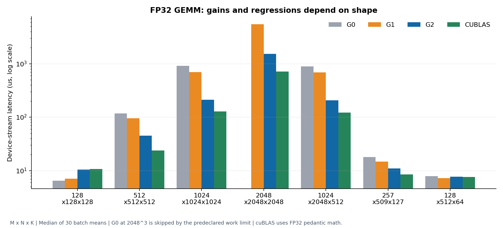

# CUDA Kernel Lab

CUDA C++ implementations of FP32 sum reduction, matrix multiplication, and bias/ReLU fusion, compared with CUB and cuBLAS on an RTX 4070 SUPER.

Reduction progresses from a shared-memory tree to warp shuffles and grid-stride loops. GEMM progresses from one output per thread to shared-memory and register tiling. Fusion adds bias and ReLU before GEMM writes its output.

## Results

| Experiment | Result |
|---|---|
| GEMM, 1024³ | Register tiling cuts device time from **907.91 to 210.98 µs** (4.30×). cuBLAS takes 128.74 µs. |
| Reduction, 67,108,864 floats | Grid-stride reduction cuts device time from **831.07 to 588.50 µs** (1.41×). |
| GEMM + bias + ReLU, 128×512×64 | Fusion cuts device time from **10.76 to 7.75 µs**. Including transfers, **81.40 vs. 80.25 µs** falls within overlapping process variation. |
| GEMM, 128³ | Register tiling is slower: **10.40 µs**, versus 6.47 µs for the baseline. |

GEMM and reduction values are medians of 30 batch means; fusion values are medians of three process medians. Comparisons use pedantic FP32 cuBLAS math. Measurements use warm buffers on one Windows system; [measurement details](docs/reproduction.md) cover timing, precision, and repeatability.



## Build and run

Requires an NVIDIA GPU, CUDA Toolkit 13.x, a compatible C++17 compiler, CMake 3.24+, Ninja, and Python 3. CMake downloads GoogleTest 1.17.0. Published results use CUDA 13.0.2, MSVC 19.39, and GPU architecture 89.

From an x64 Visual Studio Developer PowerShell:

```powershell
cmake -S . -B build -G Ninja -DCMAKE_BUILD_TYPE=Release -DCMAKE_CUDA_ARCHITECTURES=89 -DCMAKE_CUDA_FLAGS=--use-local-env
cmake --build build -j 8
ctest --test-dir build --output-on-failure
build/cuda_lab_bench.exe --op gemm --variant all --suite standard --mode device --output results/local-gemm
python scripts/summarize.py results/local-gemm
```

Use a fresh output directory for each run. On Linux, omit `-DCMAKE_CUDA_FLAGS=--use-local-env` and the `.exe` suffix; Linux GPU execution has not been validated. See the [reproduction guide](docs/reproduction.md) for offline setup, sanitizer checks, and profiling commands.

## Experiments and implementation

- [Reduction](docs/case-studies/reduction.md): fewer barriers and partial sums, cache effects, and comparison with CUB.
- [GEMM](docs/case-studies/gemm.md): register reuse, tile selection, and why small matrices get slower.
- [Fusion](docs/case-studies/fusion.md): one fewer kernel launch, and why transfers largely erase the gain.
- [Architecture](docs/architecture.md): indexing, synchronization, workspace, and numerical checks.

Tests cover empty inputs, tile boundaries, exact patterns, random values, buffer reuse, and invalid arguments. Saved GPU runs passed correctness tests and all four Compute Sanitizer tools. Small GEMMs use full CPU FP64 references; larger cases use full cuBLAS FP32 comparisons plus sampled FP64 checks. CI compiles CUDA and checks the result parser on a CPU runner.

[Validation logs](results/validation/validation.json) · [Benchmark results](results/release/summary.json) · [Profiler results](profiles/summary.json)

This version covers one GPU and FP32 CUDA-core kernels. Tensor Cores, mixed precision, cuBLASLt fusion, and multi-GPU execution are outside its scope. The [original implementation plan](docs/implementation-plan.md) is retained as design history.
