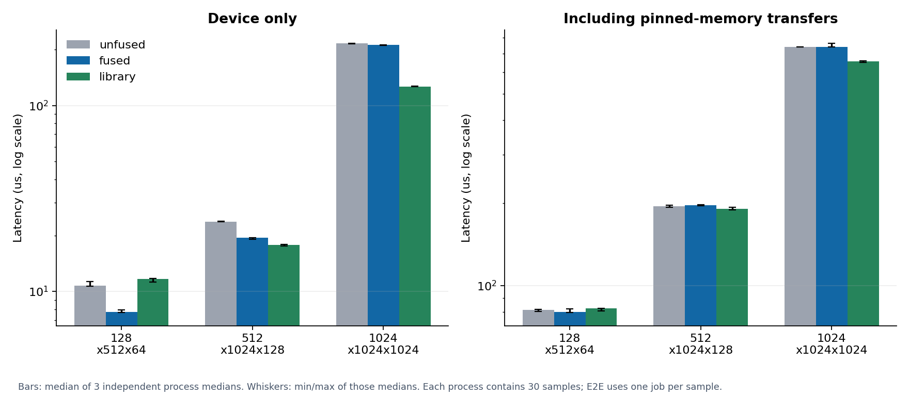

# Fusion: a clear device gain can disappear end to end

**Result:** At M=128, N=512, K=64, folding bias/ReLU into G2 improves the device operation from **10.76 to 7.75 µs (1.39×)** across three independent process medians. Transfer-inclusive medians are **81.40 versus 80.25 µs**, a small difference within the observed process variation. A kernel-only improvement is not presented as an equivalent application-level improvement.

## Controlled comparison

All three paths compute `Y = ReLU(A*B + bias[col])` with the same inputs and FP32 contract:

- Unfused: selected G2 plus one combined in-place bias/ReLU kernel.
- Fused: the same G2 tile/accumulator loop, applying bias/ReLU before the final store.
- Library: pedantic FP32 cuBLAS plus the same combined epilogue kernel.

The comparison avoids an artificially weak three-kernel baseline. Fusion removes one launch and approximately `8*M*N` logical intermediate bytes. It can change register usage or scheduling, and it does not guarantee an equal reduction in DRAM traffic.

## Unprofiled measurements

Each value is the median of three process medians, with 30 samples per process. Device samples are repeated-batch means; E2E samples are individual jobs.

| M×N×K | Unfused device, µs | Fused device, µs | Library device, µs | Device fusion speedup |
|---|---:|---:|---:|---:|
| 128×512×64 | 10.76 | 7.75 | 11.65 | 1.39× |
| 512×1024×128 | 23.73 | 19.43 | 17.73 | 1.22× |
| 1024×1024×1024 | 215.73 | 211.51 | 126.45 | 1.02× |

| M×N×K | Unfused E2E, µs | Fused E2E, µs | Library E2E, µs |
|---|---:|---:|---:|
| 128×512×64 | 81.40 | 80.25 | 82.40 |
| 512×1024×128 | 194.70 | 196.55 | 190.75 |
| 1024×1024×1024 | 739.70 | 740.80 | 657.70 |

For the smallest case, the unfused/fused device process ranges are 10.65–11.26 / 7.72–7.95 µs. E2E ranges are 80.45–81.80 / 79.90–82.20 µs, which overlap. The larger two E2E medians slightly favor unfused in this collection despite faster fused device execution. Those negative results are preserved.

## Evidence from counters and timelines

At 512×1024×128, the fused and unfused G2 kernels both use 64 registers/thread and 16 KiB static shared memory; the extra unfused epilogue uses 20 registers/thread. No local spill requests were reported. Thus, this particular fusion did not increase the reported G2 register count.

The [detail counter exports](../../profiles/detail/fusion-unfused.csv) show an additional approximately 2.12 MB of DRAM reads while profiling the separate epilogue under cache-flushed replay. The [fused report](../../profiles/detail/fusion-fused.csv) has no epilogue kernel. This supports the removal of an intermediate read operation, but it is not a warm-cache DRAM saving measurement: replay flushes cache, and some stores remain cached rather than appearing as immediate DRAM writes. The logical saving at this shape is 4,194,304 bytes (4 MiB), which must not be equated with those replay counters.

The marked Nsight Systems captures for 128×512×64 independently confirm:

| Trace content | Unfused | Fused |
|---|---:|---:|
| H2D copies (A, B, bias) | 3 | 3 |
| Compute kernels | 2 | 1 |
| D2H copies (Y) | 1 | 1 |
| CUDA stream | Same single stream | Same single stream |

See the event extracts in [`profiles/summary.json`](../../profiles/summary.json). The traces contain instrumented timings and capture overhead; they are used to verify the operation sequence, not to replace the unprofiled numbers above.

## Interpretation and stopping point

The strongest relative device gain is at the smallest K, where the removed launch/epilogue is a larger fraction of the operation. For 1024³, GEMM dominates and the relative benefit shrinks. Moving inputs/output and synchronizing a single job costs enough on this system that the E2E effect becomes small.

The library path is an appropriate unfused cuBLAS baseline, not a comparison with cuBLASLt's fused epilogues. Data-resident multi-layer pipelines, Tensor Cores, and asynchronous transfer overlap could change the application-level result; they are outside v1. The useful outcome here is a measured boundary on fusion's benefit, rather than a universal fusion-speedup claim.
