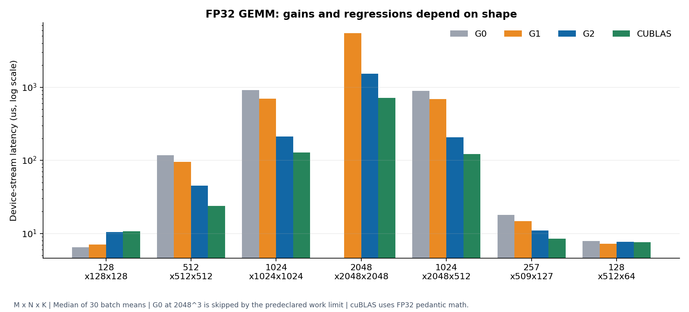

# GEMM: register reuse matters more than maximum occupancy

**Result:** For 1024×1024×1024 FP32 GEMM, G2 takes **210.98 µs**, compared with G0's 907.91 µs and G1's 693.74 µs. That is **4.30× faster than G0** and **3.29× faster than G1**, at about **61% of pedantic FP32 cuBLAS throughput** for this standard-run case. G2 is slower than G0 for the smallest square input.

## Hypothesis and implementation

G0 assigns one output per thread and repeatedly loads A/B from global memory. G1 uses 16×16 shared tiles but still computes one output per thread. G2 computes multiple outputs per thread, reusing A/B values across a 4×4 register tile (or 4×8 in one candidate). All variants retain row-major contiguous FP32 inputs, explicit FMA, zero-padded tails, and guarded output stores.

The hypothesis is that more reuse and independent accumulator work can outweigh increased register pressure. The comparison excludes TF32 and Tensor Cores: the cuBLAS adapter uses `CUBLAS_COMPUTE_32F_PEDANTIC`, not the default reduced-precision fast path.

## Unprofiled measurements

M×N×K and device-stream medians in µs, from [`gemm-device-standard`](../../results/release/gemm-device-standard/summary.json):

| Shape | G0 | G1 | G2 | cuBLAS |
|---|---:|---:|---:|---:|
| 128×128×128 | 6.47 | 7.02 | 10.40 | 10.67 |
| 512×512×512 | 117.88 | 95.04 | 45.02 | 23.78 |
| 1024×1024×1024 | 907.91 | 693.74 | 210.98 | 128.74 |
| 2048×2048×2048 | Skipped | 5,457.37 | 1,534.70 | 713.45 |
| 1024×2048×512 | 893.65 | 686.66 | 207.43 | 121.37 |
| 257×509×127 | 17.89 | 14.79 | 10.95 | 8.51 |
| 128×512×64 | 7.89 | 7.25 | 7.70 | 7.57 |

G0 at 2048³ exceeds the predeclared `M*N*K > 1024^3` limit. The skip is recorded explicitly. G2's 128³ result is about 1.61× slower than G0: larger shared/register tiles and only four output blocks offer too little parallel work to amortize overhead. The tail and rectangular cases are retained rather than reporting only aligned squares.

## Bounded tuning

Only 512³ and 1024³ were used to choose among the three G2 candidates:

| BM×BN×BK | 512³, µs | 1024³, µs |
|---|---:|---:|
| 64×64×16 | 48.54 | 224.90 |
| **64×64×32** | **44.68** | **209.19** |
| 64×128×16 | 52.99 | 247.57 |

The middle candidate became the fixed default before the evaluation suite. The wider output tile did not win. No shape-dependent autotuning or added fourth tile is hidden in the evaluation.

## Profiler evidence

Selected 1024³ observations from the [detail CSVs](../../profiles/summary.json), collected with kernel replay and cache flushing:

| Metric | G0 | G1 | G2 64×64×32 |
|---|---:|---:|---:|
| Registers/thread | 40 | 38 | 64 |
| Static shared memory | 0 | 2 KiB | 16 KiB |
| Achieved occupancy | 96.69% | 96.67% | 51.04% |
| FMA pipe active, % of sustained elapsed peak | 7.39% | 11.95% | 30.96% |
| Barrier stall proportion | 0% | 13.96% | 6.23% |
| Reported local spill requests | 0 | 0 | 0 |

The result supports the register-reuse hypothesis: G2 issues useful FMA work more effectively even though occupancy is lower. It does not prove that occupancy is irrelevant or that the kernel reaches hardware peak. The cuBLAS gap remains substantial.

The 64×64×16 candidate used 66 registers/thread and achieved 40.95% occupancy in its profile; the selected BK=32 candidate used 64 registers/thread and achieved 51.04%. A nominally smaller shared tile did not translate into better measured occupancy because register allocation also constrained resident blocks.

For shared-bank analysis, lanes in a warp span two `ty` rows, and the source A-tile row stride changes from 16 to 32 floats when BK changes. Broadcasts, compiler-generated load widths, and scheduling matter. The BK=32 report records 2,772 shared-load and 65,183 shared-store bank conflicts; BK=16 records zero in this collection. These counters do not justify claiming the selected layout is conflict-free. They also do not overturn the unprofiled result: BK=32 was faster. The active-display environment and small unexpected counter values in other reports limit exact attribution; no padding change was made without a controlled follow-up experiment.

## Transfer-inclusive result and limits

For 1024³, the median of three independent process medians is 209.46 µs device / 739.70 µs E2E for G2, and 125.24 µs device / 650.90 µs E2E for cuBLAS. Inputs and the complete output are transferred each job using preallocated pinned memory. Allocation, handle creation, and the reference computation are excluded.

This is a CUDA-core FP32 study. It is not a replacement for cuBLAS and does not compare with Tensor Core mixed precision, CUTLASS, or cuBLASLt. The next useful step would need a new precision/scope decision, rather than an unlimited expansion of this fixed-tile benchmark.
