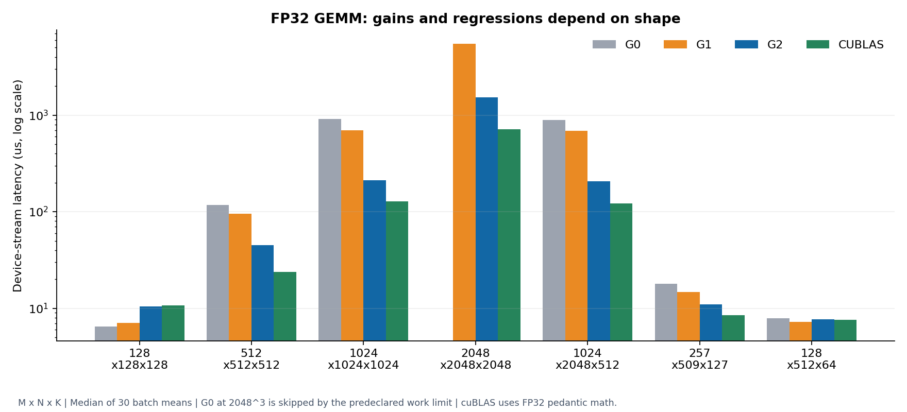

# GEMM: register reuse matters more than maximum occupancy

For 1024×1024×1024 FP32 GEMM, G2 takes **210.98 µs**, compared with G0's 907.91 µs and G1's 693.74 µs. That is **4.30× faster than G0** and **3.29× faster than G1**, at about **61% of pedantic FP32 cuBLAS throughput** for this standard-run case. G2 reuses each loaded value across several outputs, trading more registers for less repeated work. At 128³, however, its large tile leaves only four output blocks, and G2 is slower than G0.

## What changed

G0 assigns one output per thread and repeatedly loads A/B from global memory. G1 uses 16×16 shared tiles but still computes one output per thread. G2 computes multiple outputs per thread, reusing A/B values across a 4×4 register tile (or 4×8 in one candidate). All variants retain row-major contiguous FP32 inputs, explicit FMA, zero-padded tails, and guarded output stores.

The cuBLAS adapter uses `CUBLAS_COMPUTE_32F_PEDANTIC`, so these are FP32 comparisons without TF32 or Tensor Cores.

## Unprofiled measurements

M×N×K and device-stream medians in µs, from [`gemm-device-standard`](../../results/release/gemm-device-standard/summary.json):

| Shape | G0 | G1 | G2 | cuBLAS |
|---|---:|---:|---:|---:|
| 128×128×128 | 6.47 | 7.02 | 10.40 | 10.67 |
| 512×512×512 | 117.88 | 95.04 | 45.02 | 23.78 |
| 1024×1024×1024 | 907.91 | 693.74 | 210.98 | 128.74 |
| 2048×2048×2048 | Skipped | 5,457.37 | 1,534.70 | 713.45 |
| 1024×2048×512 | 893.65 | 686.66 | 207.43 | 121.37 |
| 257×509×127 | 17.89 | 14.79 | 10.95 | 8.51 |
| 128×512×64 | 7.89 | 7.25 | 7.70 | 7.57 |

G0 at 2048³ exceeds the predeclared `M*N*K > 1024^3` limit. G2's 128³ result is about 1.61× slower than G0: larger shared/register tiles and only four output blocks offer too little parallel work to amortize overhead.

## Choosing the tile

Only 512³ and 1024³ were used to choose among the three G2 candidates:

| BM×BN×BK | 512³, µs | 1024³, µs |
|---|---:|---:|
| 64×64×16 | 48.54 | 224.90 |
| **64×64×32** | **44.68** | **209.19** |
| 64×128×16 | 52.99 | 247.57 |

64×64×32 won on both tuning shapes and became the fixed default for every evaluation shape. The wider 64×128 tile was slower.

## Profiler evidence

Selected 1024³ observations from the [detail CSVs](../../profiles/summary.json), collected with kernel replay and cache flushing:

| Metric | G0 | G1 | G2 64×64×32 |
|---|---:|---:|---:|
| Registers/thread | 40 | 38 | 64 |
| Static shared memory | 0 | 2 KiB | 16 KiB |
| Achieved occupancy | 96.69% | 96.67% | 51.04% |
| FMA pipe active, % of sustained elapsed peak | 7.39% | 11.95% | 30.96% |
| Barrier stall proportion | 0% | 13.96% | 6.23% |
| Reported local spill requests | 0 | 0 | 0 |

G2 has higher FMA activity despite lower occupancy, consistent with the benefit of register reuse. These counters support that explanation but do not isolate its contribution to the speedup.

The 64×64×16 candidate used 66 registers/thread and achieved 40.95% occupancy in its profile; the selected BK=32 candidate used 64 registers/thread and achieved 51.04%. A nominally smaller shared tile did not translate into better measured occupancy because register allocation also constrained resident blocks.

For shared-bank analysis, lanes in a warp span two `ty` rows, and the source A-tile row stride changes from 16 to 32 floats when BK changes. Broadcasts, compiler-generated load widths, and scheduling matter. The BK=32 report records 2,772 shared-load and 65,183 shared-store bank conflicts; BK=16 records zero in this collection. BK=32 was faster despite these reported conflicts. The active-display environment and small unexpected counters in other reports make their exact cost uncertain.

## Including transfers

For 1024³, the median of three independent process medians is 209.46 µs device / 739.70 µs E2E for G2, and 125.24 µs device / 650.90 µs E2E for cuBLAS. Inputs and the complete output are transferred each job using preallocated pinned memory. Allocation, handle creation, and the reference computation are excluded.

See the [measurement setup and reproduction commands](../reproduction.md) for timing, precision, and hardware details.

