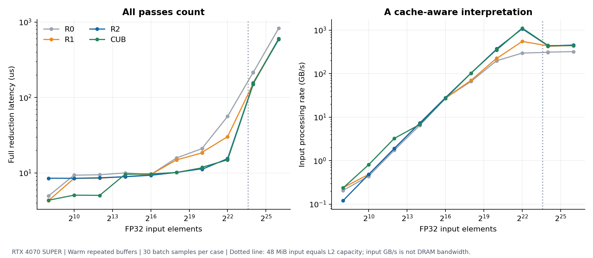

# Reduction: fewer barriers and fewer partials

**Result:** At 67,108,864 FP32 elements (256 MiB), R2 completes the full reduction in 588.50 µs versus R0's 831.07 µs: **1.41× faster than the shared-tree baseline**. At 16,777,216 elements, three independent processes put R2 and CUB near parity; there is no robust claim that this implementation beats CUB.

## Hypothesis and controlled changes

R0 performs a shared-memory tree within each 256-thread block. R1 changes only that block reduction to warp shuffles and one shared-memory exchange, keeping the input partition and pass schedule unchanged. R2 then changes only the first pass to a bounded grid-stride loop with independent accumulators; its follow-up passes are R1.

The expected benefit of R1 is less barrier/shared-memory work. R2 should reduce the number of partials and allow each block to process more input. It can still lose on tiny inputs because the fixed block size and final-pass overhead matter more than bandwidth.

## Unprofiled measurements

Device-stream medians in µs, including every pass, from [`reduce-device-standard`](../../results/release/reduce-device-standard/summary.json):

| Elements | Input | R0 | R1 | R2 | CUB |
|---:|---:|---:|---:|---:|---:|
| 256 | 1 KiB | 4.95 | 4.30 | 8.52 | 4.36 |
| 1,024 | 4 KiB | 9.37 | 8.48 | 8.50 | 5.09 |
| 1,048,576 | 4 MiB | 21.03 | 18.45 | 11.38 | 11.70 |
| 4,194,304 | 16 MiB | 56.19 | 30.28 | 15.50 | 14.95 |
| 16,777,216 | 64 MiB | 216.09 | 153.16 | 151.42 | 149.17 |
| 67,108,864 | 256 MiB | 831.07 | 600.68 | 588.50 | 603.19 |

R2 at 256 elements uses two 128-thread first-pass blocks plus a final block; R0/R1 finish with one 256-thread block. The slower R2 result is retained. No special tiny-input dispatch was added.

The input-processing rate rises above 1,000 GB/s for the 16 MiB input under warm-buffer repetition, then falls for inputs larger than the GPU's 48 MiB L2. This is an input-byte processing metric, not a claim of DRAM bandwidth. The graph marks where the input alone equals L2 capacity; other live buffers also use cache.

## Bounded tuning decision

Only 1,048,576 and 16,777,216 elements were tuning inputs. The eight candidates are recorded in [`results/tuning`](../../results/tuning/summary.json). R2 B128/A4/cap224 took 10.16/152.63 µs, and B256/A4/cap224 took 10.47/150.61 µs. The former has a slightly better two-shape geometric mean and was selected as the fixed default; these small differences do not establish a universal best setting.

The 8×SM cap permits 448 first-pass partials on this GPU, so it needs an additional R1 pass compared with the 224-partial cap. The larger grid was often slower at the smaller tuning size. This explains a concrete full-operation tradeoff that a first-kernel-only timer would miss.

## Profiler evidence

The detail reports use the same release kernel source and explicit cache-flushed kernel replay. First-pass observations at 16,777,216 elements are:

| Metric | R0 | R1 | R2 |
|---|---:|---:|---:|
| Registers/thread | 16 | 16 | 26 |
| Static shared bytes/block | 1,024 | 32 | 16 |
| Achieved occupancy | 88.58% | 77.54% | 33.18% |
| Barrier stall proportion | 28.09% | 6.42% | 0.32% |
| Long-scoreboard stall proportion | 25.93% | 66.93% | 95.57% |
| DRAM read bytes, decimal MB | 68.79 | 68.22 | 67.80 |

Sources: [R0](../../profiles/detail/reduce-r0-16777216.csv), [R1](../../profiles/detail/reduce-r1-16777216.csv), [R2](../../profiles/detail/reduce-r2-16777216.csv). The exported reports include all subsequent passes, not just these first-pass rows. No local spill requests were reported for these kernels.

The barrier observations support the intended R0→R1 change. R2's low occupancy does not imply a bad result by itself: a bounded grid can still sustain useful streaming throughput. Its dominant long-scoreboard proportion and approximately input-sized DRAM reads are consistent with waiting on memory, while its improvement over R1 is modest for the large case. Stall proportions are observations, not percentages of total wall time saved.

The small reports also show low utilization for the tiny grids; host submission and launch costs are important there. The compiled shared-address pattern is designed for contiguous accesses, but some aggregate bank/DRAM counters contain small nonzero or extra traffic on this active-display WDDM system. They are not used to assert exact algorithmic byte counts.

## Transfer-inclusive result and limits

For 16,777,216 elements, median-of-three process medians:

| Scope | R2 | CUB |
|---|---:|---:|
| Device, µs | 152.84 (151.49–153.37) | 151.77 (151.33–152.41) |
| E2E, µs | 2,714.55 (2,711.20–2,714.80) | 2,664.80 (2,660.40–2,667.55) |

Parentheses are the range of process medians. The E2E NVTX trace records a 64 MiB H2D copy, two reduction kernels, and a 4-byte D2H copy on the same stream. H2D occupied about 2.50 ms in that instrumented trace, dwarfing the approximately 0.16 ms of kernel execution. Final latency comes from the unprofiled benchmark, not this trace.

This version stops after the bounded sweep. A future small-input policy or larger hardware study could be useful, but the current evidence supports the stated baseline improvement and explains why transfer-inclusive gains are limited.
